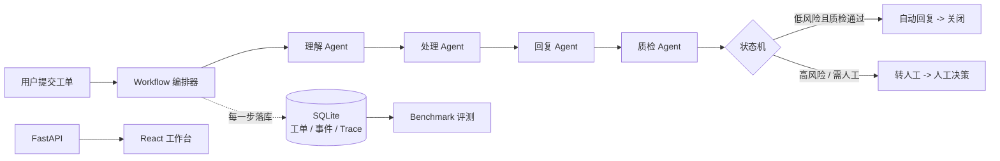

# 智能工单多 Agent 质量评测平台

> 一个前后端完整、自带 Benchmark 评测体系的多 Agent 项目：面向测试开发 / 质量工程场景，处理内部支持工单，并把「怎么证明 Agent 做得对」做成可回归的自动化评测。

[](https://www.python.org/)
[](https://fastapi.tiangolo.com/)
[](https://react.dev/)
[](https://vite.dev/)
[](https://docs.pydantic.dev/)
[](#质量验证)
[](#质量验证)
[](#质量验证)

---

## 这个项目解决什么问题

多 Agent 系统最麻烦的地方不是「能不能跑」，而是**怎么判断它每一步做得对不对、改一版有没有变差**。

本项目用一个真实可闭环的工单场景，把这件事拆成三层：

- **业务链路**：工单从提交、理解、处理、回复、质检到关闭/转人工，全流程可跑通。
- **可观测性**：每一步 Agent 的输入、输出、耗时都落库成 Trace，出问题能定位到具体环节。
- **质量评测**：用分级 Benchmark + 断言把「正确」变成可量化、可回归的指标。

## 核心流程

```text
用户提交工单
  -> 理解 Agent（分类 / 优先级 / 风险标记）
  -> 处理 Agent（知识检索 / 路由到负责组）
  -> 回复 Agent（生成回复草稿）
  -> 质检 Agent（风险判定 / 最终动作）
  -> 状态机（自动回复关闭 / 转人工 / 拒绝）
```



## 技术栈

| 层次 | 技术 |
|---|---|
| 语言 | Python 3.11+、TypeScript |
| 后端 | FastAPI、Uvicorn、Pydantic v2 |
| 前端 | React 19、Vite 6、lucide-react |
| 编排 | 自研状态机 + Workflow 编排器 |
| 存储 | SQLite（工单 / 状态事件 / Agent Trace / 评测结果） |
| 模型接入 | Provider 抽象（默认规则引擎，可插拔 OpenAI 兼容接口） |
| 测试 | pytest（unit / integration / e2e / security / regression） |

## 项目结构

```text
app/
  agents/          # 4 个业务 Agent：理解、处理、回复、质检
  orchestrator/    # 状态机与流程编排、Trace 落库
  providers/       # LLM Provider 抽象（规则引擎 / OpenAI 兼容）
  tools/           # 知识库检索、路由、风险扫描
  storage/         # SQLite 仓储
  api/             # FastAPI 接口层
benchmark/
  datasets/        # L1/L2/L3 分级数据集
  metrics/         # 断言与指标
  judges/          # Judge 抽象
  runners/         # 批量评测入口
frontend/
  src/             # React 工作台（任务队列 / Trace / 人工决策）
tests/             # pytest 测试套件
docs/              # 架构说明、面试讲法、简历要点
```

## 技术亮点

**1. 状态机驱动的流程编排**

用显式 Transition 表限制合法流转（`CREATED -> PARSING -> ... -> CLOSED`），非法跳转直接报错；已关闭是终态；高风险工单不允许自动关闭。每一次状态变化都写入事件表，链路可追溯。

**2. Trace 级可观测性**

每个 Agent 的输入、输出、耗时、状态都落成一条 Trace。缺陷可以精确定位到理解、检索、路由、回复、质检、状态或 Provider，而不是只知道「结果不对」。

**3. Provider 可插拔，默认离线可跑**

真实 LLM 有网络、费用和随机性，不适合当稳定测试基线。项目默认用规则 Provider 保证离线可跑、结果可复现；需要真实模型时只改环境变量，不动 Agent 代码。

**4. 面向评测的 Benchmark 体系**

数据集按难度分层，每条数据可断言分类、优先级、路由组、是否转人工、最终状态，把「回复得好不好」转成可量化、可回归的分数。

**5. 安全场景作为一等公民**

风险扫描覆盖 PII、凭据索取、越权承诺、Prompt Injection、投诉升级；关键风险工单强制转人工，并有专门的安全测试集验证。

## 质量验证

以下数字都来自项目内真实运行结果，可直接在本地复现：

| 项目 | 结果 |
|---|---|
| pytest 测试 | **56 passed**（10 个测试文件，覆盖 unit / integration / e2e / security / regression / quality） |
| Benchmark 用例 | **9 / 9 通过**（L1 / L2 / L3 各 3 条） |
| Benchmark 断言 | **36 / 36 通过** |
| 知识库条目 | **34 条**，探测命中率 **90.2%**（41 条真实问法） |
| 前端构建 | TypeScript 类型检查 + Vite 生产构建通过 |

复现方式见下方「快速开始」。

## 快速开始

### 环境要求

- Python 3.11+
- Node.js 20+ 与 pnpm

> 注意：项目必须放在 **NTFS** 磁盘（如 D 盘）。不要放在 FAT32 盘符上，否则 pnpm 无法创建符号链接，前端依赖会安装失败。

### 1. 安装依赖

```powershell
cd D:\agent_pro

# 后端依赖
python -m pip install pydantic fastapi uvicorn pytest

# 前端依赖
cd frontend
pnpm install --config.node-linker=hoisted
cd ..
```

### 2. 一键启动（后端 8000 + 前端 5173）

```powershell
powershell -ExecutionPolicy Bypass -File .\start.ps1
```

启动后访问：

| 入口 | 地址 |
|---|---|
| App 工作台 | http://127.0.0.1:5173/ |
| 后端接口文档 | http://127.0.0.1:8000/docs |
| 独立演示页 | http://127.0.0.1:5173/standalone.html |

## 使用方式

### 命令行

```powershell
# 跑一条工单
python -m app.cli run-ticket --text "AF205 喂食器连不上 Wi-Fi，显示错误码 E104，请尽快处理"

# 运行 Benchmark
python -m app.cli benchmark --dataset benchmark/datasets/tickets_l1_l3.jsonl

# 查看数据库中的工单
python -m app.cli show-ticket --ticket-id 1

# 运行测试
python -m pytest
```

### 接口

| 方法 | 路径 | 说明 |
|---|---|---|
| GET | `/api/health` | 运行时健康状态 |
| POST | `/api/tickets` | 提交工单并跑完整 Agent 链路 |
| GET | `/api/tickets` | 工单列表 |
| GET | `/api/tickets/{id}` | 工单详情（含事件与 Trace） |
| POST | `/api/tickets/{id}/decision` | 人工决策（确认 / 关闭 / 拒绝） |
| GET | `/api/benchmark` | Benchmark 评测结果 |

## 接入真实 LLM

默认使用规则引擎，无需 API Key 即可运行和测试。需要真实模型时：

```powershell
$env:TICKET_AGENT_PROVIDER="openai_compatible"
$env:OPENAI_API_KEY="..."
$env:OPENAI_BASE_URL="https://dashscope.aliyuncs.com/compatible-mode/v1"
$env:TICKET_AGENT_MODEL="qwen-plus"
```

## 更多文档

- [架构说明](docs/architecture.md)：分层设计、状态机、风险模型、Benchmark 设计
- [面试讲法](docs/interview-guide.md)：一句话介绍、常见追问、可量化指标
- [简历要点](docs/resume-bullets.md)：可直接使用的项目描述

## 设计取舍

- 不使用复杂外部 Agent 框架，降低复现成本，链路更容易讲清楚。
- Agent 不直接操作数据库，由 Workflow 统一落库，便于 Trace 与评测。
- 所有 Agent 输入输出使用 Pydantic Schema 强校验，避免脏数据在链路中传递。
- 默认规则 Provider 让测试稳定、可离线运行；真实 LLM 作为可插拔能力。

## 快速开始

```powershell
cd D:\agent_pro

# 后端依赖
python -m pip install pydantic fastapi uvicorn pytest

# 前端依赖（项目使用 pnpm，store 已指向 D:\pnpm-store）
cd frontend
pnpm install --config.node-linker=hoisted
cd ..

# 一键启动后端 8000 + 前端 5173
powershell -ExecutionPolicy Bypass -File .\start.ps1
```

启动后访问：

- App 工作台：http://127.0.0.1:5173/
- 后端接口文档：http://127.0.0.1:8000/docs
- 独立演示页：http://127.0.0.1:5173/standalone.html

> 注意：本项目必须放在 NTFS 磁盘（如 D 盘）。不要放在 FAT32 的盘符上，
> 否则 pnpm 无法创建符号链接，前端依赖会安装失败。

运行测试：

```powershell
python -m pytest
```

运行一条演示工单：

```powershell
python -m app.cli run-ticket --text "AF205 喂食器连不上 Wi-Fi，显示错误码 E104，请尽快处理"
```

运行 Benchmark：

```powershell
python -m app.cli benchmark --dataset benchmark/datasets/tickets_l1_l3.jsonl
```

查看数据库中的工单：

```powershell
python -m app.cli show-ticket --ticket-id 1
```

## 环境变量

默认使用规则引擎，无需 API Key 即可运行和测试。

接入真实 LLM 时设置：

```powershell
$env:TICKET_AGENT_PROVIDER="openai_compatible"
$env:OPENAI_API_KEY="..."
$env:OPENAI_BASE_URL="https://dashscope.aliyuncs.com/compatible-mode/v1"
$env:TICKET_AGENT_MODEL="qwen-plus"
```

## 目录

```text
app/
  agents/          # 理解、处理、回复、质检
  orchestrator/    # 状态机与编排
  providers/       # LLM Provider 抽象
  tools/           # 知识库、路由、风险扫描
  storage/         # SQLite 仓储与 Trace
benchmark/
  datasets/        # Benchmark 数据
  metrics/         # 指标与断言
  judges/          # LLM Judge 抽象
  runners/         # 批量评测入口
tests/             # pytest 测试
```

## 设计取舍

- 不使用复杂外部 Agent 框架，降低复现成本，便于面试讲清链路。
- Agent 不直接操作数据库，由 Orchestrator 统一落库。
- 所有 Agent 输入输出使用 Pydantic Schema 强校验。
- 默认规则 Provider 让测试稳定、可离线运行；真实 LLM 作为可插拔能力。
